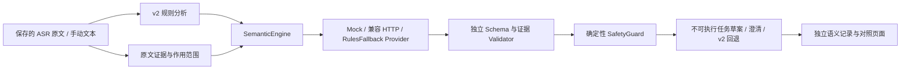

# InspectionBrain v3 第一阶段技术设计

## 审计事实

2026-10-09 从源码及新建对象确认：`electrical_terms_v2.json` 实际加载版本为 electrical-v2.3，SHA256 为 `fe43978ba1363d84905c556eb5b50f9da3d494cc7f8d026a7e46de5ba5eb24b7`。无 v2.1/v2.2 版本选择逻辑；历史记录保留生成时版本，运行服务的加载版本需查看 `/api/config`，不能由磁盘版本推断。

`ElectricalBrainV2` 保留 raw_transcript、term_normalized_text、整理文本、候选及轨迹，原文是编号、数值及权限判断依据。测试台从已保存音频元数据读取真实 ASR，忽略客户端伪造转写；分析、人工确认评分、重新识别分开，记录幂等并按音频 SHA256 去重。`workflow_version=voice-workflow-v3` 是既有评分协议版本，不代表已存在本轮 LLM 引擎。

v2 已有设备实体、未核验编号、数值格式转换、上海时区比较约束、多意图和不可执行 MissionDraft。审计复现：设备自我纠正的两个编号均作为未解析实体保留；数值自我修正未建立接受/否定关系。知识库均为示例，不能支持现场诊断。既有知识问答 LLMProvider.compose 是带来源回答接口，本轮语义 Provider 另设接口。

原 inspection_brain 包有禁止网络/硬件导入的回归保护。本轮新包使用兄弟目录 brain_v3，保留该边界。SenseVoice 隔离环境与模型不变。

## 模块与数据流

Provider 输入包括原文、规范化文本与候选、原文设备/数值/时间证据、有限文本对话上下文以及安全限制。原始音频、知识文档、台账、人工参考答案不进入模型请求。上下文只能解释对话，不能创建本轮未出现的设备身份或数值。

新 JSON Schema 使用封闭字段、枚举、原文字符位置及引用 ID；包含多意图、实体、时间、否定、自我修正、条件、依赖、数据需求、澄清及任务草案。所有 source_span 均为 Python 字符位置，直接引用 original_request，而非纠错文本。数值使用字符串避免浮点误差。现场唯一身份始终未核验，文本序号不等于台账 ID。

Validator 独立检查 Schema 和原文证据、编号与设备绑定、精确数值/单位/相别、否定/自我修正/条件、时间解析及依赖 DAG、完整性和禁止现场结论。模型不能新增设备、将否定目标激活、遗漏明确限制或改变数值。无法验证的意图解释要求澄清；冲突结果不作为可用草案。SafetyGuard 不依赖模型：authorized/executable/hardware_commands_enabled 均强制 false，要求人工确认，无执行端点或工具。

## Provider 与回退

默认 Provider 为 RulesFallback，默认页面仍为 v2。Mock 为脚本化离线契约演示，不是真实 LLM。OpenAICompatible 仅实现可配置 Chat Completions 文本 HTTP 协议，不依赖厂商 SDK。默认禁用网络；配置 enable=true 后才允许调用本地文本服务。非 loopback 地址还须显式 allow_external_text=true 并使用 HTTPS，作为用户主动授权文本外发的配置；本轮不启用。限制超时、响应长度、输出 token，禁止重定向，环境变量注入 API key，不写入记录或页面。

v3_llm 模式显示不可用/校验拒绝及澄清；auto 模式另附明确标记的 v2 回退。回退不伪装成模型推理。模型输出只能提出不可执行业务草案，不能产生工具调用或控制授权。

## 增量接入与评测

新增 `/api/semantic`、`/api/semantic/records` 和独立对照面板，现有 `/api/evaluate`、CER、参考确认与 v2 默认行为保持。新语义记录位于独立目录，关联 audio_id/SHA、模型配置摘要、原文 SHA、词库版本/SHA、语义协议版本和时间。历史记录只读；重复请求幂等，版本对照不增加独立音频样本数。

语义标注独立于 ASR 参考：需人工确认设备关系、意图、否定、数值、时间、自我修正及依赖。已有真实音频按 SHA 去重，导出待标注开发清单，不将转写自动当作语义金标准。合成安全挑战单列。未确认标注不计语义正确率；Schema/拦截/耗时/回退可作工程指标。不会宣称 LLM 改善 SenseVoice CER。

## 实施和验证顺序

1. 新增 brain_v3、Schema、Provider 配置、证据/校验/草案及 CLI；先运行离线与恶意输出测试。
2. 新增独立语义标注/评测、真实历史音频开发清单；运行去重与无金标准保护测试。
3. 小幅接入测试台服务、独立前端模块与面板；保持 v2 默认及原评分流程，运行 Python/Node 回归。
4. 临时 loopback 服务读取已有真实 WAV，运行真实 SenseVoice → v2/v3(Mock/回退) → 记录链路。Windows Chrome 未实际自动化时明确未验证。

预计修改范围：新增 brain_v3/*、docs/V3*、tests/test_v3*、reports/v3*；调整 voice_lab/server.py、static/index.html、新 static/v3.js 和 pyproject.toml。不修改机器人工程、v2 核心、词库、ASR 环境/模型及既有数据。
