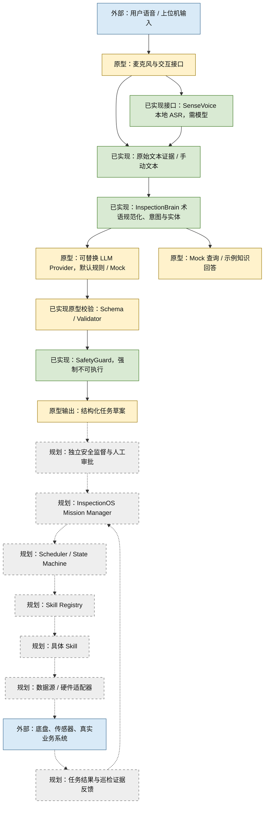

# Power Inspection Robot · 电力巡检机器人

上海电力大学大学生创新创业训练计划（大创）项目，面向电力设备巡检的移动机器人软件与系统工程实践。项目曾作为上海电力大学大创项目代表，在 **2026 年中国国际工业博览会（工博会）**进行现场展示。

当前公开仓库以 [InspectionBrain](InspectionBrain/README.md) 语音与电力领域语义实验室为主。**理解查询意图不代表已接入真实业务系统，结构化任务草案不代表机器人可以执行任务。** InspectionOS 是下一阶段建设目标。

## 项目背景与应用场景

目标场景包括变电站及电力设备巡检、设备运行状态查询、红外测温记录查询、历史测温比较、告警查询、自然语言语音交互，以及移动巡检、环境建图和巡检记录展示。这些是应用目标，并非全部已经实现。

当前查询演示使用明确标记的 Mock 台账、记录和示例知识。尚未接入真实 SCADA、DMS、EMS 或设备台账；模拟结果不能用于现场状态判定。

## 工博会展示经历

根据项目成员提供的现场经历，实验室中曾运行语音前进、后退、左转、右转及瞬时速度、角速度反馈；展厅复杂无线环境下，机器人与上位机通信及线上平台访问不稳定，语音控制和识别文本展示受到影响。团队重新启用手持遥控器进行人工控制，并保留自动建图、双摄像头相关视觉展示和部分巡检记录展示。

这些整机经历与当前公开仓库的离线语义原型属于不同证据范围，不能据此声称本仓库包含当时整机控制代码或已完成真机集成。完整分析见[工博会工程复盘](docs/EXHIBITION_REVIEW.md)。

## 硬件配置

以下设备名称和用途来自项目提供的信息；仓库未附完整硬件清单或实测规格。

| 设备 | 主要用途 | 系统位置 | 配置确认状态 |
|---|---|---|---|
| Scout 移动机器人底盘 | 承载与移动 | 硬件执行平台 | 系列已知；具体型号、速度、载荷与控制协议待补充 |
| NVIDIA Jetson AGX Xavier | 边缘计算 | 本地计算平台 | 平台名称已知；系统、部署环境及资源配置待补充 |
| RS16 激光雷达 | 环境感知与建图相关能力 | 感知层 | 名称已知；具体参数、驱动与建图关联待补充 |
| 双摄像头配置 | 现场视觉感知与展示 | 视觉感知层 | 具体型号、分辨率、视场角与安装位置待补充 |
| 海康云台摄像机相关设备 | 视频采集与云台控制 | 视频与云台设备层 | 具体型号、接口及与双摄像头的关系待补充，暂不合并 |
| 麦克风 | 采集语音指令 | 交互输入层 | 型号、采样配置和连接方式待补充 |
| 手持遥控器 | 人工接管与备用控制 | 人工控制通道 | 现场使用已说明；链路和接管优先级配置待补充 |
| 无线网络设备 | 机器人、上位机与控制平台通信 | 通信层 | 型号、拓扑、频段和协议待补充 |

不根据设备系列推定规格。建图传感器组合、算法、定位精度及红外干扰源均需以实际实现和测试核实。

## 核心技术与本人负责的工作

本人工作以机器人软件架构、智能语义理解和任务调度方向为主；整机硬件集成及现场保障为团队工作，不全部归于个人。

### InspectionBrain：语音与电力领域语义理解

负责语音输入与 ASR 接入、SenseVoice 本地识别实验、电力术语词库与规范化、转写纠错候选和原文保护，以及领域意图、设备实体、编号、时间、数值和否定关系处理。软件输出保留原文证据、不确定性和结构化任务草案，使用语义 Schema、Validator 与 SafetyGuard 约束输出。

纠错不是无条件改写：同音词、口误和复杂表达可能需要人工确认，设备编号也不自动成为真实设备身份。源码入口包括 [v2 领域语义](InspectionBrain/inspection_brain/domain_v2/service.py)和[本地 ASR](InspectionBrain/voice_lab/asr.py)。

### InspectionBrain v3：可替换文本模型探索

已有 Provider 抽象接口、Mock Provider、RulesFallback Provider、OpenAI Compatible Provider，以及结构化 JSON、原文证据验证和不可执行草案原型。Mock 是脚本化契约演示，RulesFallback 是规则回退，均不是真实模型推理。

据项目成员提供的信息，Qwen3 4B Instruct 已下载并通过 Ollama 命令行测试；**尚不能认定已完成 InspectionBrain v3 真实模型集成**。仍需验证模型输出能否通过现有 Schema 和 Validator，以及设备、数值、否定与条件关系是否保真。本项目没有训练专用电力大模型的成果声明。详见 [v3 技术说明](InspectionBrain/docs/V3.md)。

### InspectionOS：下一阶段架构设计

规划 Mission Manager、Skill Registry、Scheduler、State Machine 和 Safety Supervisor，负责任务生命周期、调度、状态及独立安全监督。当前尚未完成，本次仅记录设计，不开发任务内核或接入硬件。

## 系统总体架构

下图为目标架构；节点文字与颜色共同表示状态，箭头不表示已经完成集成。文本输入可绕过 ASR；Provider 是可替换候选生成路径，不是所有查询都必须调用大模型。



现有 SafetyGuard 仅约束语义输出，不是整机安全认证或人工授权服务。规划中的执行安全监督必须独立于模型，不能将“校验通过”解释为允许运动。详见[总体架构](docs/ARCHITECTURE.md)。

## 软件模块划分

| 模块 | 职责 | 边界 / 状态 |
|---|---|---|
| 语音测试台与 ASR | 采集、上传、转写和对照展示 | 独立实验接口；本地模型需另行安装 |
| InspectionBrain v2 | 术语、意图、实体、规则语义及示例知识 | 已有实现；不验证现场事实 |
| InspectionBrain v3 | Provider 候选、Schema、证据校验、安全封装 | 独立原型；无运动执行权限 |
| InspectionOS | 任务生命周期与 Skill 调度 | 规划中；不是 Brain 内的草案数据结构 |
| Skill 与真实适配器 | 执行业务步骤、访问真实数据或硬件 | 后续建设；Mock 接口不等于真实接入 |
| 数据与证据管理 | 原文、音频、来源、版本与分析记录 | 实验记录已有；整机证据闭环待建设 |

## 工博会现场问题与工程经验

| 问题 | 现场表现 | 已采取措施 | 后续方向 |
|---|---|---|---|
| 语音交互 | 控制链路与识别文本展示不稳定 | 遥控器备用 | 本地化语音链路、分环节诊断 |
| 无线网络 | 通信中断、平台访问不稳定、控制受延迟影响 | 人工接管 | 独立局域网、质量监测、超时重连与离线运行 |
| 运动安全 | 通信延迟带来失控风险与载荷风险 | 底层停车保护、速度和转向限制 | 独立安全监督与故障注入验证 |
| 环境建图 | 自动建图及部分展示仍可运行 | 保留可用功能展示 | 多传感器稳定性验证 |
| 电梯红外干扰 | 进入电梯后电梯门无法正常关闭 | 记录现场问题 | 干扰源排查与兼容性测试 |

**通信延迟超过底层配置的安全阈值时触发停车保护，具体阈值以实际控制程序和配置为准。** 不将口述中不确定的 200ms 或 500ms 作为已验证参数。网络展示失败不能直接归因于 SenseVoice 识别准确率；电梯干扰机理也尚未确定。

机器人系统不能只追求运动控制的灵敏度，还必须考虑通信异常情况下的失效安全。详细事实、证据边界和验证建议见[现场复盘](docs/EXHIBITION_REVIEW.md)。

## 当前开发进度

| 模块 | 当前状态 | 证据范围 |
|---|---|---|
| SenseVoice ASR | 已有本地识别接口和既有实验记录 | 源码及原技术文档；当前 checkout 不包含模型，不代表已部署 Xavier |
| 电力术语规范化 | 已有规则实现 | 词库、规范化与原文保护代码 |
| InspectionBrain v2 | 已有领域语义分析 | 规则与示例知识、Mock 数据 |
| InspectionBrain v3 | 已有 Provider、Schema、Validator 原型 | 兼容客户端存在；真实模型效果待验证 |
| Qwen3 4B Instruct | Ollama 命令行测试完成，真实项目接入待验证 | 项目成员提供的信息，非本仓库集成验收 |
| Mission Manager / Skill Registry | 规划中 | 现有 mission.py 仅定义不可执行草案协议 |
| InspectionOS | 尚未完成 | 无完整任务内核 |
| 真实设备台账接入 | 待建设 | 当前为 Mock |
| 真实巡检记录查询 | 待建设 | 当前为 Mock，现场记录展示不等于此仓库已接真实数据 |
| 完整自主任务执行 | 未实现 | 公开语义链路不能执行机器人动作 |

## 后续技术路线

1. **Phase 1 · InspectionBrain v3**：接入真实文本模型，验证 Qwen3 结构化 JSON、Schema、原文证据、设备与数值关系、否定、自我修正和条件约束；记录拒绝、回退与实际耗时。
2. **Phase 2 · InspectionOS v0.1**：使用 Python 建立独立任务内核，包含 Mission Manager、Skill Registry、Scheduler、State Machine、Safety Supervisor；先用模拟数据，不直接控制真实硬件。
3. **Phase 3 · 模拟巡检任务系统**：开发告警查询、红外测温记录查询、历史测温比较、设备异常复检建议 Skill；模拟结果始终标识来源。
4. **Phase 4 · 硬件适配与可靠性**：逐步验证本地网络自治、控制接口适配、传感器接入、执行监控、故障恢复与人工接管。满足独立安全与现场验证条件后再讨论真机执行。

以上均为后续路线，不代表现有能力。

## 快速开始

需要 Python 3.10 或以上。以下离线文本演示无第三方运行依赖，不需要硬件、ASR 模型或文本大模型。从仓库根目录运行：

```bash
python3 InspectionBrain/cli.py '电流互感器和电压互感器有什么区别？'
python3 InspectionBrain/run_v3_demo.py '制定巡检计划，但不要启动导航'
python3 InspectionBrain/run_v3_demo.py '不是2号断路器，是3号断路器' --provider rules --mode auto_fallback
```

第一条使用示例知识；第二条默认为 Mock；第三条展示规则回退。所有结果均不能用于驱动真机。可选手动文本测试台：

```bash
python3 InspectionBrain/run_voice_lab.py --asr none --semantic-provider mock
```

测试台仅监听本地回环地址，Ctrl+C 停止；此模式不执行真实语音识别。SenseVoice 安装、模型与音频验证要求见[语音实验说明](InspectionBrain/docs/VOICE_LAB.md)及[第二轮说明](InspectionBrain/docs/ROUND2.md)。不要把原文档中的历史机器路径当作当前部署路径。

## 文档导航

- [系统总体架构与模块合同](docs/ARCHITECTURE.md)
- [2026 年工博会工程复盘](docs/EXHIBITION_REVIEW.md)
- [InspectionBrain 原有说明](InspectionBrain/README.md)
- [v3 使用说明](InspectionBrain/docs/V3.md) · [v3 设计](InspectionBrain/docs/V3_DESIGN.md) · [既有验证报告](InspectionBrain/docs/V3_VALIDATION.md)
- [既有集成边界](InspectionBrain/docs/INTEGRATION.md) · [语音实验室](InspectionBrain/docs/VOICE_LAB.md)

## 安全声明与项目边界

- InspectionBrain 的语义理解不等于现场事实验证；Mock 数据不是真实设备台账或巡检记录。
- 设备编号必须经过真实台账核验；示例知识不能代替现场规程和授权。
- LLM 输出不能直接作为硬件控制命令，也不应获得底盘控制权限。
- InspectionOS 当前属于后续建设目标，安全审批必须独立于模型输出。
- 当前公开仓库中的任务草案不可直接执行机器人动作；Schema 通过不授予执行权。

本文中的硬件及展会经历来自项目成员提供的信息；软件状态以当前仓库源码为依据。未补充的硬件参数、现场数据和模型效果不作推定。
