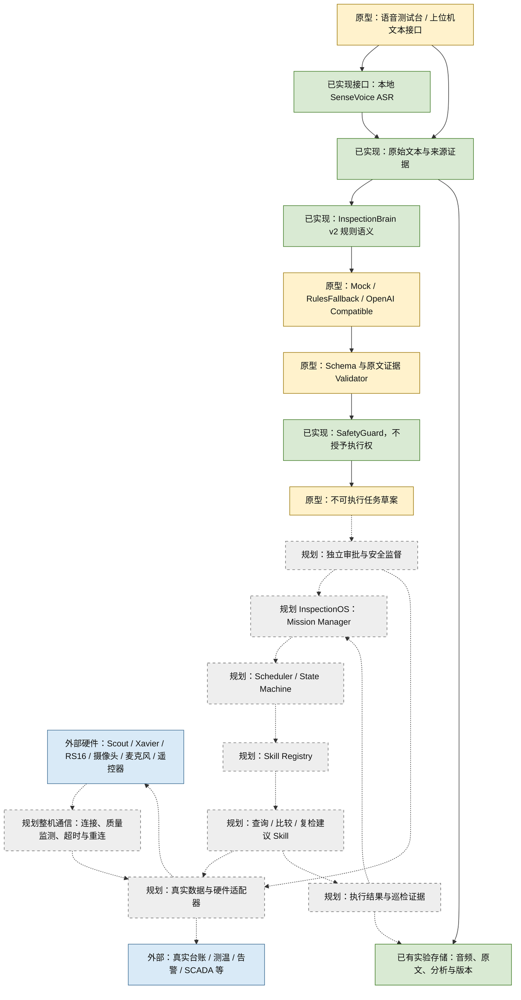

# 电力巡检机器人总体架构（初始规划快照）

> 本文保留新增任务运行时之前的规划状态。当前 Mock 内核、数据管线与验证边界请以[系统架构](SYSTEM_ARCHITECTURE.md)和[验收报告](VALIDATION_REPORT.md)为准；下文“规划中”属于历史上下文，不表示当前 Mock 代码仍缺失。

[返回项目首页](../README.md) · [工博会复盘](EXHIBITION_REVIEW.md)

## 1. 范围与证据

本文定义软硬件分层、模块合同及未来集成边界。当前公开代码集中在 `InspectionBrain/`，不包含完整整机系统、底盘驱动或 InspectionOS 实现。硬件与现场经历来自项目成员提供的信息，具体规格以实际设备、控制程序和配置为准。

状态用语：**已实现**表示存在相应源码；**原型 / Mock**表示实验或模拟合同；**规划**表示尚待建设；**外部**表示仓库之外的设备或系统。源码存在不等于已完成真机部署或生产验收。

## 2. 分层与目标数据流

实线表示当前实验链路内的数据关系，虚线表示待建设的集成关系。语音可经过 ASR，手动文本直接进入原文证据层。v2 可直接处理规则语义、示例知识与 Mock 查询；Provider 不是所有输入必经的真实 LLM。实验存储已存在，整机结果回流仍属规划。

## 3. 十层模块合同

| 层 / 模块 | 负责什么 | 输入 | 输出 | 依赖 | 不应该负责 | 当前状态 |
|---|---|---|---|---|---|---|
| 机器人硬件层 | 移动、感知、边缘计算和人工操作通道 | 物理环境、合规控制信号、供电 | 传感数据、运动与设备状态 | Scout、Xavier、RS16、摄像头等设备 | 解释自然语言或自行决定业务授权 | 外部；配置来自成员说明，规格待核实 |
| 设备通信层 | 整机消息传递、连接状态、时延和异常处理 | 设备消息、网络状态 | 带时效与来源的消息、连接故障事件 | 网络设备、设备协议、控制平台 | 将网络恢复视为自动恢复运动授权 | 现场链路曾运行；公开仓库无完整实现，协议待补充 |
| 语音交互层 | 录音、WAV 上传、手动文本、结果与纠错候选展示 | 用户音频 / 文本、人工参考 | 音频样本、输入来源、分析请求 | 麦克风、浏览器、测试台服务 | 把用户口述“批准”转换成执行授权 | 独立测试台原型，非整机控制平台 |
| ASR 语音识别层 | 本地音频转写、分段和推理状态报告 | 采样配置明确的 PCM 音频、本地模型与 tokens | 原始转写、模型信息、耗时或失败 | SenseVoice / sherpa-onnx、numpy、模型文件 | 确认设备身份、测量事实或任务执行权限 | 已有本地接口及既有实验记录；当前 checkout 不附模型 |
| 电力领域语义理解层 | 原文保护、术语候选、意图与实体关系、候选 JSON 校验 | 原始文本、有限上下文、版本与参考时间 | 带证据的语义、不确定项、不可执行草案 | v2、Provider、Schema、Validator、SafetyGuard | 直接控制底盘、验证现场事实、伪造测量或授权 | v2 已实现；v3 为独立原型，真实模型集成待验证 |
| InspectionOS 任务操作系统层 | 任务受理、生命周期、调度、状态与故障处理 | 经独立核验的草案、授权、Skill 状态 | 任务实例、调度请求、状态与审计事件 | Mission Manager、Registry、Scheduler、State Machine、安全监督 | 重新猜测用户意图、绕过审批或充当硬件驱动 | 规划中；不是已有草案协议的别名 |
| Skill 技能执行层 | 实现单项有边界的业务步骤与结果合同 | 已调度任务、已核验设备与数据请求 | 结果、证据、明确错误与状态 | Registry、数据适配器、必要的硬件适配器 | 接收自由模型文本直接执行动作或自行提升权限 | 规划中；先实现模拟查询、比较、复检建议 |
| 硬件适配与控制层 | 将受约束请求映射到具体设备接口并报告执行状态 | 经安全检查的请求、限幅与时效条件 | 设备反馈、失败、停止结果 | 实际驱动、通信层、底层保护 | 接收未经审批的 LLM 输出或屏蔽底层停车保护 | 公开仓库未实现；现场底层保护仅有成员说明 |
| 安全监督层 | 语义约束、未来独立授权、通信与执行安全门控 | 候选语义、身份核验、人工审批、通信和设备状态 | 拒绝、澄清、停止或受限授权决定 | 当前 Validator / SafetyGuard；未来 Supervisor 与底层保护 | 让模型自证安全、把 Schema 合法当现场授权 | 语义安全封装已有；执行级 Supervisor 和审批服务规划中 |
| 数据与证据管理层 | 保存来源、原文、音频关联、版本和分析；未来执行审计 | 音频、ASR、语义结果、未来任务事件 | 可追溯记录、导出、证据关联 | 实验文件存储、SemanticStore；未来真实数据系统 | 将 Mock 当真实记录、覆盖原始转写或历史数据 | 实验存储已有；整机证据与真实数据接入待建设 |

硬件详细配置及待核实字段见[首页硬件表](../README.md#硬件配置)。双摄像头与海康云台摄像机保持独立条目；不假定它们就是同一套设备。

## 4. InspectionBrain 与 InspectionOS 的区别

**InspectionBrain 回答“用户表达了什么”；InspectionOS 管理“经核验的任务如何推进”。** Brain 可提出查询目标、所需数据和限制，不能确认设备在现场的真实身份，也不能替代任务执行审批。

| 对比项 | InspectionBrain（当前） | InspectionOS（规划） |
|---|---|---|
| 管理对象 | 原文、语义、证据和草案 | 任务实例、状态、资源与执行事件 |
| 核心接口 | `ask` / `analyze`、候选校验 | 未来任务受理、调度、取消与恢复合同 |
| 失败处理 | 拒绝候选、保留原文、澄清或规则回退 | 未来超时、取消、故障、恢复及人工接管 |
| 权限 | `authorized=false`、`executable=false`、`hardware_commands_enabled=false` | 未来仍需独立授权与安全监督，不由模型授予 |
| 当前证据 | v2/v3 源码与实验测试 | 架构规划，无完整内核实现 |

`inspection_brain/mission.py` 只有 MissionDraft / MissionDraftSink 草案与离线预览合同，不是 Mission Manager。语义里的任务依赖也不是已运行的 Scheduler。

### 现有 v3 处理次序

1. 保留原文，由 v2 构建基础语义与证据；记录参考时间和词库版本。
2. 根据模式选用规则、Mock 或显式配置的兼容 Provider。Mock 不产生真实模型推理。
3. 对候选执行封闭 Schema 与原文证据校验，检查设备、编号、数值、单位、时间、否定、自我修正、条件及依赖关系。
4. SafetyGuard 重建不可执行草案；失败时拒绝或在指定模式下规则回退。任何路径均不能授予运动权限。
5. 由独立实验存储记录来源与结果；没有连接真实任务执行器。

源码：[engine.py](../InspectionBrain/brain_v3/engine.py)、[providers.py](../InspectionBrain/brain_v3/providers.py)、[Validator](../InspectionBrain/brain_v3/validator.py)、[SafetyGuard](../InspectionBrain/brain_v3/safety.py)、[Schema](../InspectionBrain/brain_v3/semantic-v3.schema.json)。校验是有限规则边界，不保证覆盖任意中文歧义。

### 未来任务内核的职责

| 组件 | 计划职责 | 明确边界 |
|---|---|---|
| Mission Manager | 受理、核验前置条件、维护任务身份和生命周期 | 不直接使用模型输出作为执行命令 |
| Skill Registry | 登记技能输入输出、能力和权限要求 | 存在技能不代表获得调用授权 |
| Scheduler | 根据依赖、资源及安全条件安排步骤 | 不越过禁止事项和人工接管状态 |
| State Machine | 定义合法状态迁移、超时、取消和故障处理 | 不将重连自动解释为继续运动 |
| Safety Supervisor | 独立检查授权、设备身份、通信时效与运行约束 | 不依赖模型自报安全；不能替代底层保护 |

以上组件均为规划。先以 Python 和模拟数据建立任务内核，真实执行接口留待后续独立建设与验证。

## 5. 模型、数据与执行边界

Qwen3 4B Instruct 的 Ollama 命令行测试由项目成员提供，不能替代兼容接口、Schema、Validator 的端到端验收。`OpenAICompatibleProvider` 客户端已有，默认未启用真实 LLM；具体配置与限制见[v3 说明](../InspectionBrain/docs/V3.md)。不声称训练了电力专用大模型。

未来交接应核验设备台账身份、真实数据来源与时效、人工审批、技能权限和前置条件。不能简单把现有草案的 `executable` 改为 true。模型、规则、台账与授权均需独立记录来源；查询无记录不等于设备正常。

SCADA、DMS、EMS、实时传感器和真实巡检库是潜在外部系统，当前未接入。已有 [Mock 适配接口](../InspectionBrain/inspection_brain/adapters.py)及 [Mock 数据](../InspectionBrain/inspection_brain/data/mock_records.json)仅用于实验。现场部分记录展示也不证明当前公开代码接入了这些系统。

## 6. 可靠性与失效安全

现场经历说明语音采集、ASR、网络传输、平台展示和执行链路必须分开观测。后续应采用本地优先设计，并验证离线 ASR、本地语义、独立局域网、质量监测、超时重连、任务容错与人工接管；这些尚未全部实现。

现场已说明设置底层停车保护、速度限制与转弯轮组旋转角度限制，以降低失控与载荷掉落风险。**通信延迟超过底层配置的安全阈值时触发停车保护，具体阈值以实际控制程序和配置为准。** 本仓库未提供该控制程序，不能把这些措施归于当前 SafetyGuard，也不能声称已完成安全认证。

电梯门异常需独立开展兼容性调查；机器人红外设备与电梯光幕之间的干扰只是待验证假设，不据此确定具体源头、频率或修复方案。

## 7. 分阶段建设与验证目标

| 阶段 | 建设目标 | 后续应验证的结果 |
|---|---|---|
| Phase 1：Brain v3 | 真实文本模型接入 | Qwen3 JSON、Schema、原文证据、设备与数值关系、否定、自我修正和条件约束；记录失败与回退 |
| Phase 2：OS v0.1 | Python 独立任务内核、模拟数据 | 任务生命周期、注册、调度、状态迁移、独立安全监督；不直接控制真机 |
| Phase 3：模拟任务 | 告警查询、红外记录查询、历史比较、异常复检建议 Skill | 输入输出合同、模拟证据、失败处理与不可执行边界 |
| Phase 4：硬件与可靠性 | 网络自治、控制适配、传感器接入、监控与恢复 | 通信异常停车、人工接管、故障恢复及环境兼容性；参数以实测和配置为准 |

本文定义路线，不实现 InspectionOS，也不将建议的验收目标写成已通过测试。
