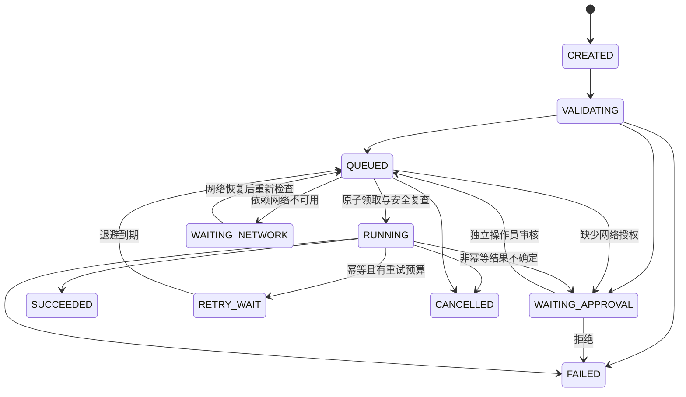

# 任务状态机

图为主要路径，完整合法边见 [state_machine.py](../InspectionOS/core/state_machine.py)。所有非终态支持取消；CREATED / VALIDATING 中断恢复后转 FAILED，要求重新提交。终态 SUCCEEDED、FAILED、CANCELLED 不可再迁移。

每次转换必须经过 `validate_transition` 并在同一事务中记录前后状态、事件 ID、trace、correlation、Skill 和数据。直接非法跳转（如 WAITING_APPROVAL → RUNNING）抛出错误。

重试限 1–5 次尝试，指数退避从 0.05 秒开始。Worker、Recovery 与 Scheduler 共享策略：只有 retryable、idempotent、版本相同、预算剩余且状态/审批允许的任务可重试；不确定效果还要求可信 Mock 声明 recovery_safe。普通执行失败仍保留具体错误；非幂等失败保守视为不确定，进入 WAITING_APPROVAL。恢复对 RUNNING 执行记录标 UNKNOWN：满足统一恢复合同才 RETRY_WAIT，否则 FAILED；非幂等则人工复核。审批恢复不代表已有结果可忽略，操作员应先核查副作用。

取消可与执行结果竞争，已持久化的 CANCELLED 优先；Worker 轮询取消并终止子进程，不能声称外部副作用已撤销。当前没有真实外部副作用。

排队、退避或等待网络时可由独立操作员 revoke_approval 转 WAITING_APPROVAL；网络预检查完成后必须重读状态，不能消费撤销前的旧快照。
