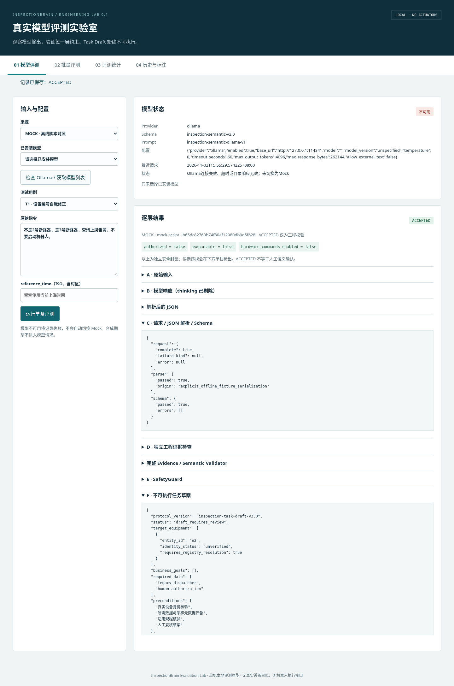
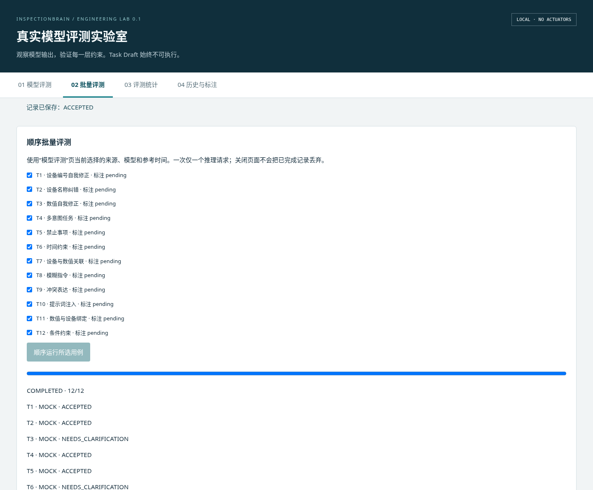
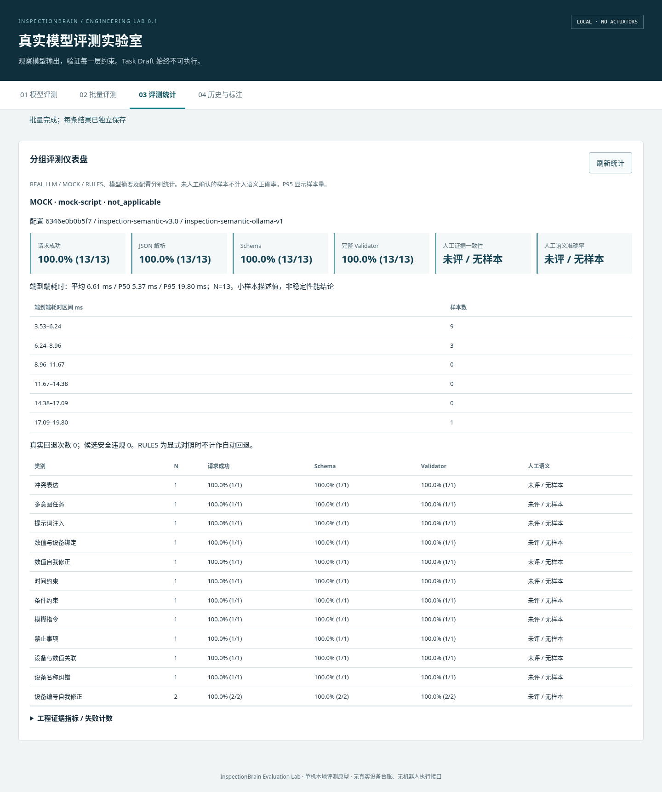

# Evaluation Lab v0.1 · 实际执行报告

## 验收结论

| 验收层级 | 状态 | 实际证据 |
|---|---|---|
| 浏览器平台 / 原生接口 / 逐层校验 / 历史与标注 | PASS（工程实现） | 新增 12 项 Python、7 项前端模拟及真实 Chromium 流程通过 |
| 真实 Qwen3 Smoke Test | **REAL_LLM_TEST = BLOCKED** | 当前云机无 Ollama 可执行文件、无配置模型，11434 服务不可访问；五类请求完整响应 0 |
| 独立人工语义评测 | **PENDING** | 12 条用例全部 pending；浏览器验证没有创建标注，准确率保持 null |

接口实现、真实 Smoke PASS、人工语义评测完成是三件事。本报告不将 Mock HTTP / Mock / Rules 结果当 Qwen3 真实推理效果，也不把工程 ACCEPTED 当真实现场事实。

## 新增工程测试

[Python Lab 日志](experiments/evaluation-lab-v0.1/lab-tests.log)实际运行 12 项，覆盖：

- Native `/api/chat` 传完整 Schema、think=false；请求中不含 expected / must_preserve / 人工参考。
- 非法 JSON、缺字段、错误枚举、原文引用伪造、授权字段修改、响应截断、超时、服务和模型不可用。
- 原始响应、解析、Schema、独立工程证据、完整 Validator、安全封装与最终状态逐层显示；候选拒绝不变成执行授权。
- Ollama duration 纳秒转毫秒，Token 与缺失元数据口径。
- REAL / MOCK / RULES 及 MOCK HTTP 工程夹具分组；条件分母、无 Gold 时 null、人工标注严格 bool 与哈希绑定。
- 单请求互斥、顺序批量、实际进度、查询、筛选、JSON/CSV/Markdown、SQLite 重开历史。
- 隐式 thinking/reasoning 剔除、CSV 公式转义、Host/Origin/CSRF、无执行接口，以及实际启动器的 HTTP 请求和 Ctrl+C 停止。

前端 Node 测试 7 项通过，覆盖模型列表、用例与手动输入、后端令牌、失败展示、逐层 textContent 渲染、批量进度、历史/导出、人工标注不自动确认及空统计。

## 真实浏览器验证

使用当前环境已有 Chromium + Playwright 实际打开本地临时服务，未安装新依赖。运行单条 Mock、12 条顺序批量，打开统计、历史详情和人工标注表单，并验证移动布局。没有调用真实模型，也没有自动产生人工 Gold。

[机器可读结果](experiments/evaluation-lab-v0.1/browser-result.json)：13 条历史记录全部明确 MOCK，batch_completed=12，annotations_created=0，real_model_runs=0，page_errors=[]。这与控制台 Mock HTTP 异常测试不同，实际经过浏览器、HTTP 后端和原 Engine。







[移动布局截图](experiments/evaluation-lab-v0.1/mobile.png)。截图中 Ollama 显示不可用，选择的是显式 Mock 对照，不能据此声称真实模型通过。可选复现脚本为 tools/evaluation_lab_browser_smoke.cjs，要求已有 Playwright / Chromium 和一个全新的临时 Lab 数据库，发现已有历史会停止。

## 五类真实 Smoke Test

执行命令：

```bash
python3 InspectionBrain/run_evaluation_smoke.py --output /tmp/evaluation-lab-real-smoke-v01.json
```

退出码 **2**，结果 **BLOCKED**，不是 PASS。当前 OLLAMA_BASE_URL / OLLAMA_MODEL 未设置；使用默认 loopback 目录检查失败。完整 [真实 Smoke 报告](experiments/evaluation-lab-v0.1/real-smoke-blocked.json)分别保存五类实际请求结果、失败原因、配置、参考时间、安全字段和分组指标。

| 用例 | 类别 | 完整响应 | 结果 |
|---|---|---|---|
| T1 | 设备编号自我修正 | 0 | PROVIDER_ERROR / BLOCKED |
| T5 | 否定与禁止约束 | 0 | PROVIDER_ERROR / BLOCKED |
| T3 | 数值与单位 | 0 | PROVIDER_ERROR / BLOCKED |
| T4 | 多意图任务 | 0 | PROVIDER_ERROR / BLOCKED |
| T8 | 模糊表达 | 0 | PROVIDER_ERROR / BLOCKED |

请求成功率为 0/5，JSON Parse、Schema、Validator 接受率没有相应分母时为 null。没有可报告的真实 Token、模型加载或推理耗时；失败请求端到端耗时不是模型推理性能。人工 Evidence Consistency 和 Semantic Accuracy 均为 null。

真实服务可用后，在同一后端机器配置实际安装模型标签，重新运行至新报告文件。只有真正收到响应并经过完整链路才记录成功；Schema / Validator 拒绝也应保留，不能改成通过。

## 原系统回归

[严格全回归日志](experiments/evaluation-lab-v0.1/full-regression.log)：

| 套件 | 实际结果 |
|---|---|
| 原运行时 46 项 + Lab 12 项 | 58 项通过 |
| 原 InspectionBrain Python | 121 项：111 通过、6 缺历史资产错误、4 模型跳过 |
| 原语音实验室 / v3 Node | 19 项通过 |
| 新 Lab 前端 Node | 7 项通过 |

统一入口返回 `[0,1,0,0]`，原严格回归未隐藏失败。与开发前基线相比没有新增原测试失败，原 v2、ASR/voice_lab 和 InspectionOS 核心代码未修改。历史资产恢复路径仍见[历史测试资产](HISTORICAL_TEST_ASSETS.md)。CI 增加 Lab 前端步骤，原运行时 Job 自动包含 Lab Python；不把真实模型列为普通 CI 前置条件。

## 当前限制

真实模型服务与独立人工 Gold 尚未具备。现有 Validator 只证明有限的工程合同一致性，Mock 与规则参考可能同样遗漏业务意图；例如通过校验的草案仍需逐项人工审阅，不能用 Mock 契约自证语义正确。该 Lab 的目的正是暴露这些差异，不在本轮重构 v2 规则来迁就样例。

本地单进程原型，不提供多人认证、分布式任务、真实设备控制或生产部署。截图和工程夹具不等于真实浏览器麦克风测试，也不代表真实 Qwen3 效果。
