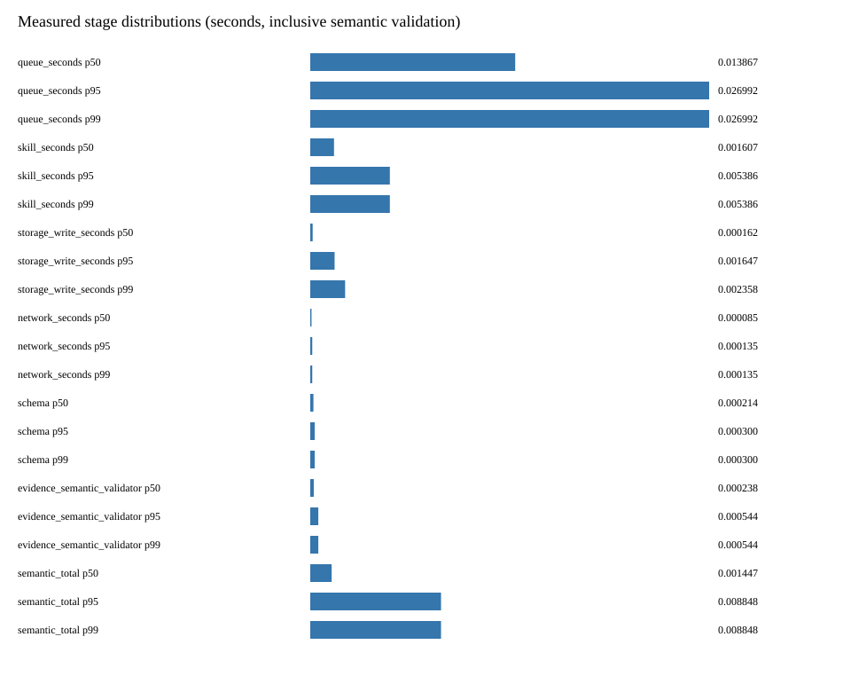
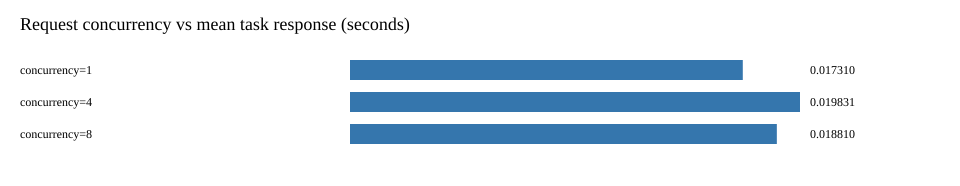
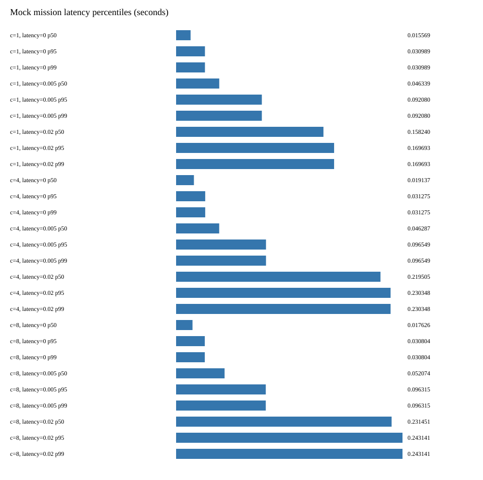
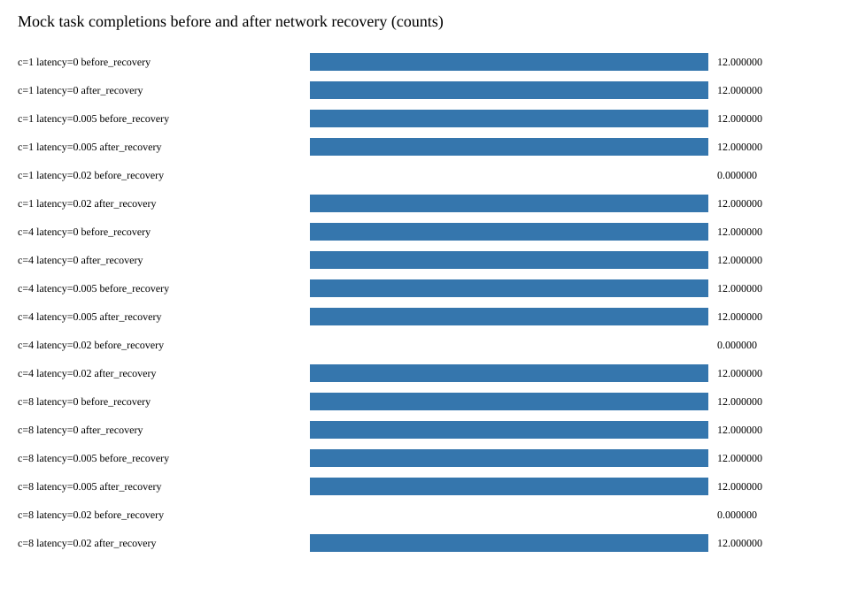
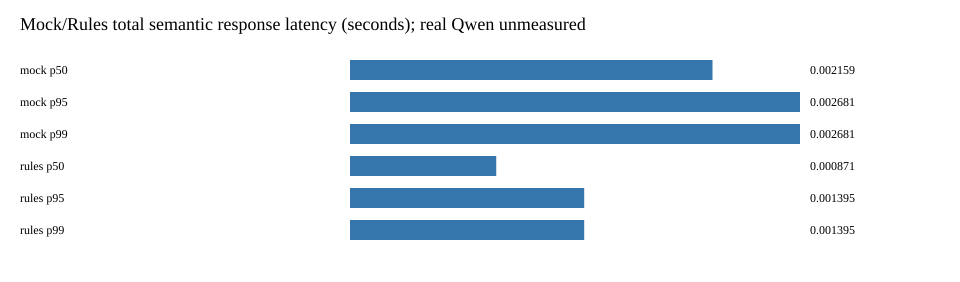

# 性能实验报告：可靠性 Follow-up

本轮在网络预检查移出 SQLite 事务后重新运行。全部是当前云主机、单 Worker、固定 Mock 数据；无真实 Qwen3、ASR、Xavier 或真机性能声明。

历史报告及数字保留：[上轮报告原文](experiments/followup-v1/performance_report-before.md)、[上轮原始数据](experiments/benchmark/measurements.json)。本轮记录独立保存，不改旧日志和时间戳。

## 网络等待与写事务解耦

[并发竞态原始记录](experiments/followup-v1/scheduler-timings.json)：预检查由 Event 阻塞，另一条 SQLite 连接提交新任务后，仍保持预检查阻塞 0.1 秒，再释放。期间原任务被取消，最后领取数为 0。

- 网络等待实测：100.793 ms。
- 另一连接提交耗时：0.415 ms。
- 本应用数据库事务最大耗时：0.444 ms。
- 网络等待时 SQLite in_transaction：False；提交已在释放网络前完成：True。

这项证明依赖线程同步与独立连接写入顺序，不依赖某个不稳定的“必须快于 N ms”断言。网络预检查可以重复，状态重核验确保同任务只领取一次。

## 重跑 9 组性能实验

命令：`python3 -m observability.benchmark --output /tmp/followup-benchmark --tasks 12`。并发提交 1/4/8；模拟网络延迟 0/5/20 ms，超时 10 ms；每组 12 个任务，Worker 始终一个。高延迟组先等待网络，恢复后继续，108/108 完成。

[本轮原始数据](experiments/followup-v1/benchmark/measurements.json) · [环境与代码版本](experiments/followup-v1/benchmark/environment.json)

| 提交并发 | 模拟延迟 ms | 任务响应 P50 ms | P95 ms | P99 ms | 数据库事务 P95 ms | 网络请求 P95 ms | Skill P95 ms | 恢复后成功 |
|---|---|---|---|---|---|---|---|---|
| 1 | 0 | 15.569 | 30.989 | 30.989 | 1.647 | 0.135 | 5.386 | 12/12 |
| 1 | 5 | 46.339 | 92.080 | 92.080 | 0.332 | 5.127 | 2.413 | 12/12 |
| 1 | 20 | 158.240 | 169.693 | 169.693 | 0.520 | 10.203 | 4.826 | 12/12 |
| 4 | 0 | 19.137 | 31.275 | 31.275 | 0.515 | 0.162 | 3.617 | 12/12 |
| 4 | 5 | 46.287 | 96.549 | 96.549 | 0.504 | 6.290 | 3.453 | 12/12 |
| 4 | 20 | 219.505 | 230.348 | 230.348 | 0.638 | 10.199 | 2.394 | 12/12 |
| 8 | 0 | 17.626 | 30.804 | 30.804 | 0.809 | 0.166 | 2.666 | 12/12 |
| 8 | 5 | 52.074 | 96.315 | 96.315 | 0.355 | 5.107 | 5.784 | 12/12 |
| 8 | 20 | 231.451 | 243.141 | 243.141 | 0.502 | 10.156 | 3.499 | 12/12 |

## 本轮真实记录生成的图表

## 解释边界

数据库事务、网络请求和 Skill 计时分开报告，网络时间不再包含在写事务中。任务响应仍包含排队和恢复等待；semantic_total 与 Validator 等计时有包含关系，不能相加当互斥阶段。12 个任务的小样本 P95/P99 接近极值，不是生产 SLA。

两轮数据来自不同实际运行，不控制操作系统噪声、缓存和调度，不能把所有性能差异都归因于代码变化。只有独立连接在阻塞预检查中仍能写入的顺序证明，直接验证事务边界。

规则/Mock 响应时间不是真实模型延迟；人工 Gold 未确认，human_gold_accuracy=null。新 Evidence Constraint 指标有独立检查和分母，无 JSON 解析观测时为 null，不能沿用旧 evidence_consistency_acceptance_rate 作为独立证据。

E5 是同进程运行时重建，E6 是执行期间 SIGKILL；[本轮故障结果](experiments/followup-v1/faults/summary.json)与[修订记录](experiments/faults/REVISION_FOLLOWUP.md)保持编号并区分含义。
