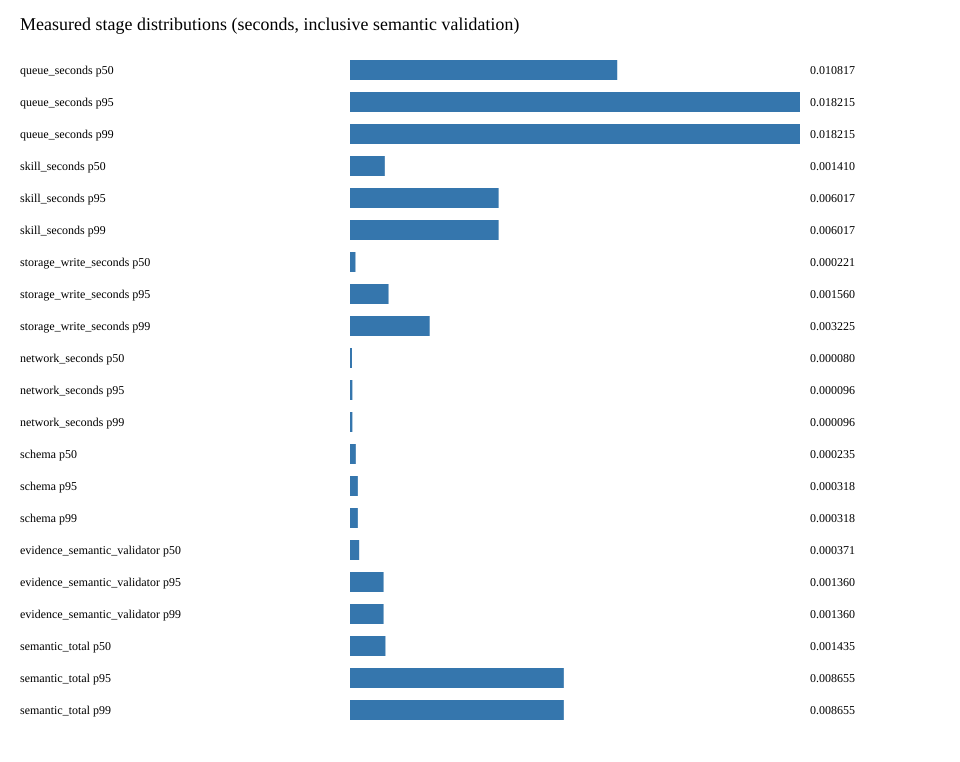
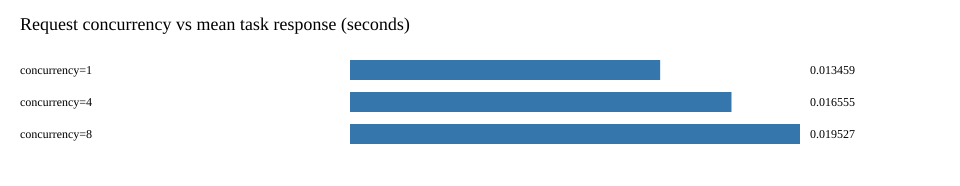
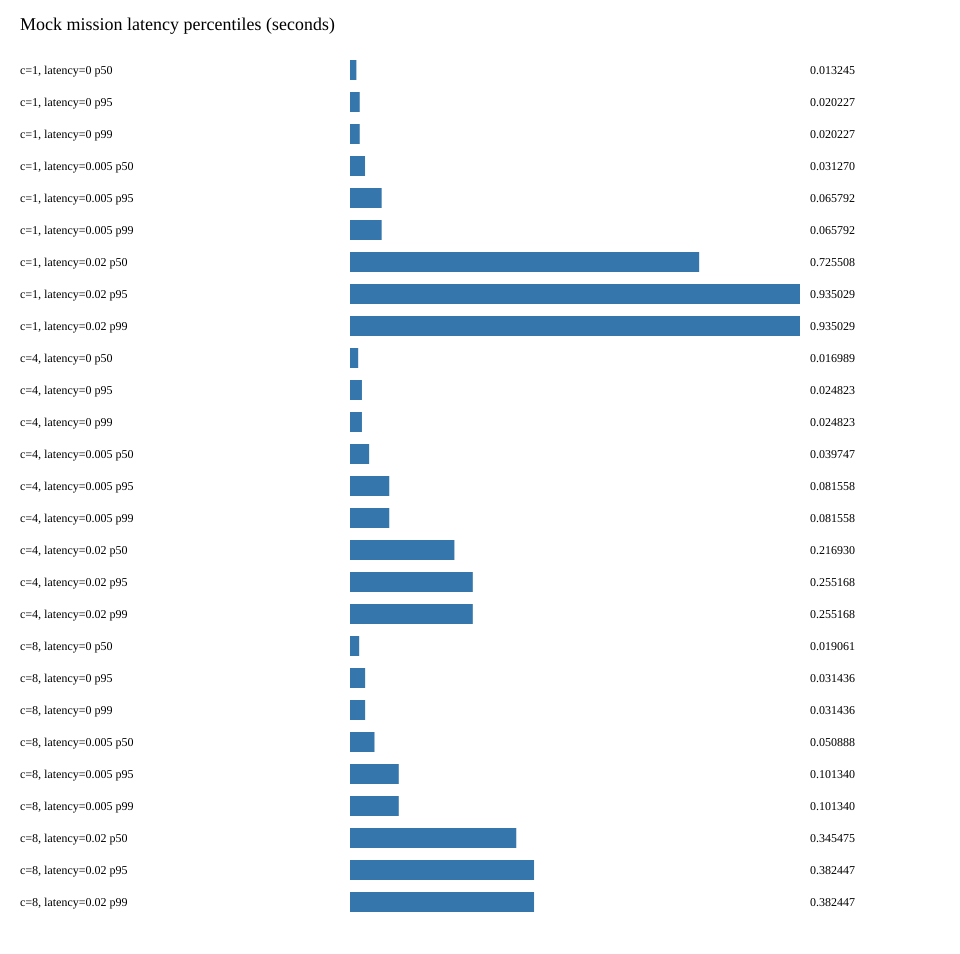
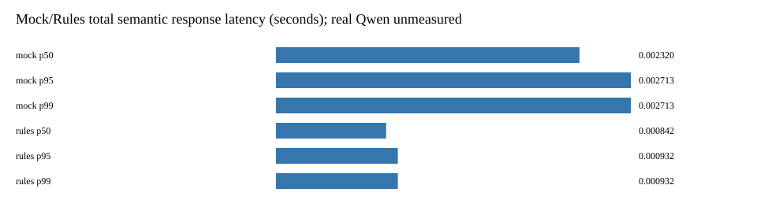

# 性能实验报告

所有数据来自当前云主机运行的单机 Mock 系统，不是 Xavier 或真机实测。真实 Qwen3 与 ASR 均未接入；不将规则或 Mock 的时延当模型时延。

运行命令：`python3 -m observability.benchmark --output /tmp/inspection-delivery-bench --tasks 12`。每组并发提交 12 个请求，单 Worker；模拟延迟 0、5、20ms，超时 10ms。报告响应时间包含排队及网络恢复等待。

[环境信息](experiments/benchmark/environment.json) · [原始计量](experiments/benchmark/measurements.json) · [单条/批写数据](experiments/benchmark/batch-writes.json)

| 并发请求 | 模拟延迟 ms | 任务数 | 恢复前成功 | 恢复后成功 | P50 ms | P95 ms | P99 ms | 吞吐 task/s |
|---|---|---|---|---|---|---|---|---|
| 1 | 0 | 12 | 12 | 12 | 13.245 | 20.227 | 20.227 | 346.82 |
| 1 | 5 | 12 | 12 | 12 | 31.270 | 65.792 | 65.792 | 129.63 |
| 1 | 20 | 12 | 0 | 12 | 725.508 | 935.029 | 935.029 | 12.54 |
| 4 | 0 | 12 | 12 | 12 | 16.989 | 24.823 | 24.823 | 346.63 |
| 4 | 5 | 12 | 12 | 12 | 39.747 | 81.558 | 81.558 | 125.27 |
| 4 | 20 | 12 | 0 | 12 | 216.930 | 255.168 | 255.168 | 43.10 |
| 8 | 0 | 12 | 12 | 12 | 19.061 | 31.436 | 31.436 | 282.14 |
| 8 | 5 | 12 | 12 | 12 | 50.888 | 101.340 | 101.340 | 109.16 |
| 8 | 20 | 12 | 0 | 12 | 345.475 | 382.447 | 382.447 | 29.40 |

## 实际图表

## 存储批写对比

同样写入 200 条合成证据，计时含 Collector 序列化、校验和及 SQLite 事务。三组分别使用独立数据库，数值为本次运行，不是重复实验置信区间。

| 批大小 | 记录数 | 耗时 s | records/s |
|---|---|---|---|
| 1 | 200 | 0.009646 | 20734.54 |
| 20 | 200 | 0.005463 | 36607.48 |
| 100 | 200 | 0.005172 | 38668.52 |

## 分析与局限

20ms 延迟超过本实验 10ms 超时，任务先进入 WAITING_NETWORK，恢复后完成；这是受控软件实验，不是现场控制阈值。并发度表示请求提交量，不是 Worker 数量。每组 12 条任务，P95/P99 在小样本下接近最大值，不应据此给出生产 SLA。

阶段计时有包含关系：semantic_total 包含 Validator；evidence_semantic_validator 包含原有 Schema 检查；Skill 时间含进程开销。不能将这些阶段相加当互斥流水线总时间。数据库事务和 fork 开销可能主导低成本 Mock 任务。

模型对照仅记录 Mock 与规则语义运行：规则在严格 v3_llm 模式会明确未连接模型，不能当作真实推理成功。真实模型成功数为 0，人工标注准确率未测。后续需在具备 Ollama、Qwen3 和独立复核标注的环境中运行真实 smoke，再单独统计准确率和模型延迟。
