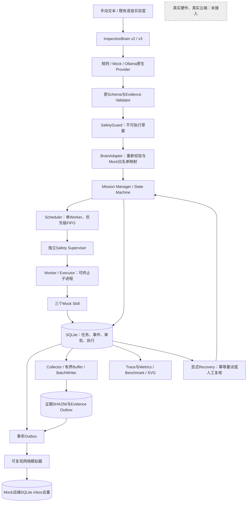

# 边缘模拟任务系统架构

[首页](../README.md) · [模块边界](MODULE_BOUNDARIES.md) · [验收记录](VALIDATION_REPORT.md)

当前版本是 Python / SQLite 单机 Mock 运行时，未接真实硬件、台账、SCADA 或生产云端。ASR 原实验室保持独立；原有硬件控制源码不在此仓库。本地 Ollama Provider 已实现和完成 Mock HTTP 验证，真实 Qwen3 尚未实测。

执行权来自可信的本地注册元数据和独立操作员审批，不来自 Brain 输出。这里的“执行”只指模拟业务函数；草案原有 `executable=false` 等字段不会变成硬件授权。

## 实际实现与局限

- `InspectionBrain/brain_v3/ollama.py`：Ollama `/api/chat`、`format=SCHEMA`、非流式 JSON、超时与有界原响应诊断。
- `InspectionOS/`：独立任务内核、Mock Skills、运行隔离、持久化与恢复；不依赖模型即可运行。
- `observability/`：任务/事件追踪、真实本地计时、最近秩百分位、单 Worker 性能实验。
- `data_pipeline/`：证据采集、背压、批写、延迟同步、保留策略与 SHA-256。

不支持分布式调度、真实物理副作用、任意复杂语义到任务 DAG 的自动执行或硬件安全认证。跨 Skill 复合请求、未解析时间、未知设备映射和条件请求会明确拒绝并要求进一步分解或澄清。
