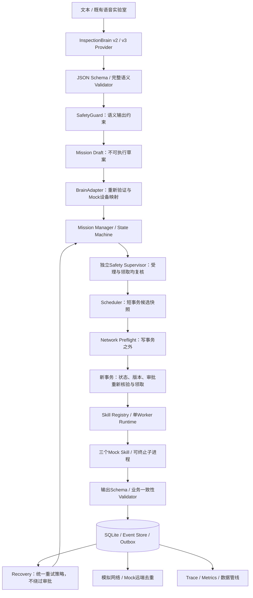

# 边缘模拟任务系统架构

[首页](../README.md) · [模块边界](MODULE_BOUNDARIES.md) · [验收记录](VALIDATION_REPORT.md)

当前版本是 Python / SQLite 单机 Mock 运行时，未接真实硬件、台账、SCADA 或生产云端。ASR 原实验室保持独立；原有硬件控制源码不在此仓库。本地 Ollama Provider 已实现和完成 Mock HTTP 验证，真实 Qwen3 尚未实测。

执行权来自可信的本地注册元数据和独立操作员审批，不来自 Brain 输出。这里的“执行”只指模拟业务函数；草案原有 `executable=false` 等字段不会变成硬件授权。

## 实际实现与局限

- `InspectionBrain/brain_v3/ollama.py`：Ollama `/api/chat`、`format=SCHEMA`、非流式 JSON、超时与有界原响应诊断。
- `InspectionOS/`：独立任务内核、Mock Skills、运行隔离、持久化与恢复；不依赖模型即可运行。
- `observability/`：任务/事件追踪、真实本地计时、最近秩百分位、单 Worker 性能实验。
- `data_pipeline/`：证据采集、背压、批写、延迟同步、保留策略与 SHA-256。

不支持分布式调度、真实物理副作用、任意复杂语义到任务 DAG 的自动执行或硬件安全认证。跨 Skill 复合请求、未解析时间、未知设备映射和条件请求会明确拒绝并要求进一步分解或澄清。

## Follow-up：事务、恢复与输出合同

Scheduler 已分为候选准备事务、事务外 Network Preflight、重读任务并原子领取的提交事务；网络等待不持有数据库连接互斥锁或 SQLite 写锁。预检查期间取消、撤销审批或其他状态迁移会令快照失效；重新读取状态、updated_at、Skill 版本与审批后才允许 RUNNING。

Worker、Recovery 与 RETRY_WAIT 重新调度共用 retry_decision，显式检查 retryable、幂等、版本、预算、状态与审批。不确定效果还要求可信 Mock 能力声明 recovery_safe；否则进入 WAITING_APPROVAL 复核。恢复不会替模型批准任务。

Skill Registry 验证 JSON 输入输出后，再调用具体 Skill 的 request/result 业务钩子，检查设备允许集合、记录时间和 Mock 来源。Schema 合法但业务错误的结果不能写成成功。审批只接受真正 bool，actor 是本地审计标签而非已认证身份。

完整变更与验证见[可靠性修复说明](RELIABILITY_FOLLOWUP.md)。历史性能、E5/E6 原始记录保留，通过修订说明和新实验目录说明差异。
